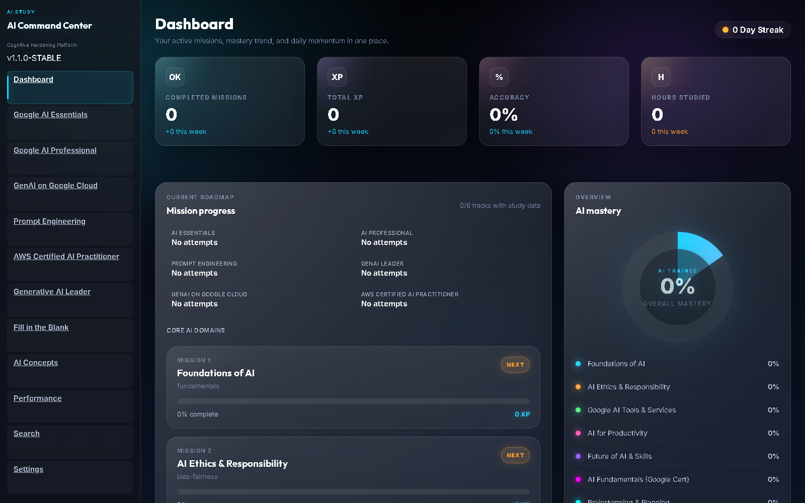
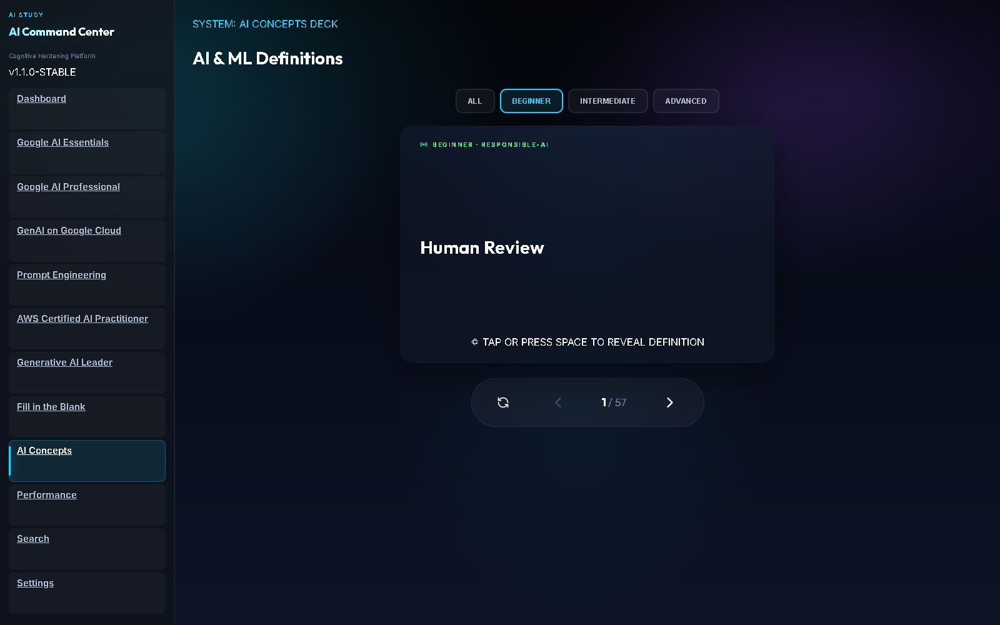
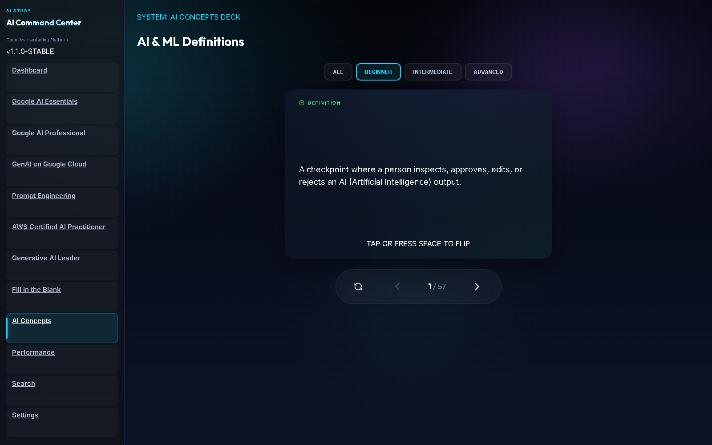

# AI Study Game (Windows, Tauri + React)

Interactive AI study game app with quiz tracks, flashcards, progress analytics, and local session data.

## Screenshots

Browser previews of the version available in this repository. The Windows desktop app is required for the full quiz database and saved progress.

### Study dashboard

Browse the study tracks and see the dashboard layout. This browser preview shows an empty study history.



### AI concept flashcards

Choose a difficulty and practice AI terminology at your own pace.



### Reveal the definition

Click a card or press Space to read its explanation.



## Tech stack

- Frontend: React + TypeScript + Vite
- Desktop shell: Tauri v2
- Local DB: SQLite via `@tauri-apps/plugin-sql`

## Run locally (friend setup)

### 1) Install prerequisites

On Windows, install:

1. Node.js 20+ (LTS recommended)
2. Rust (stable) via rustup
3. Visual Studio Build Tools (Desktop development with C++)
4. WebView2 Runtime (usually already present on Windows 11)

### 2) Clone and install

```powershell
git clone <YOUR_REPO_URL>
cd "AI STUDY GAME WINDOWS 11"
npm install
```

### 3) Run desktop app (Tauri)

```powershell
npm run dev:app
```

### 4) Run web-only dev mode (optional)

```powershell
npm run dev
```

## Build

Build web assets:

```powershell
npm run build
```

Build Windows installer/exe (Tauri):

```powershell
npm run tauri build
```

Output is generated under `src-tauri/target/release/bundle/`.

## Scripts

- `npm run dev` - Vite web dev server
- `npm run dev:app` - Launch Tauri desktop app with local dev server
- `npm run build` - TypeScript + Vite production build
- `npm run preview` - Preview built web app
- `npm run tauri build` - Build desktop app binaries/installers

## Notes

- Repo ignores local logs, local DB files, and build artifacts.
- App data is local to each machine, so each user gets their own progress/session history.
